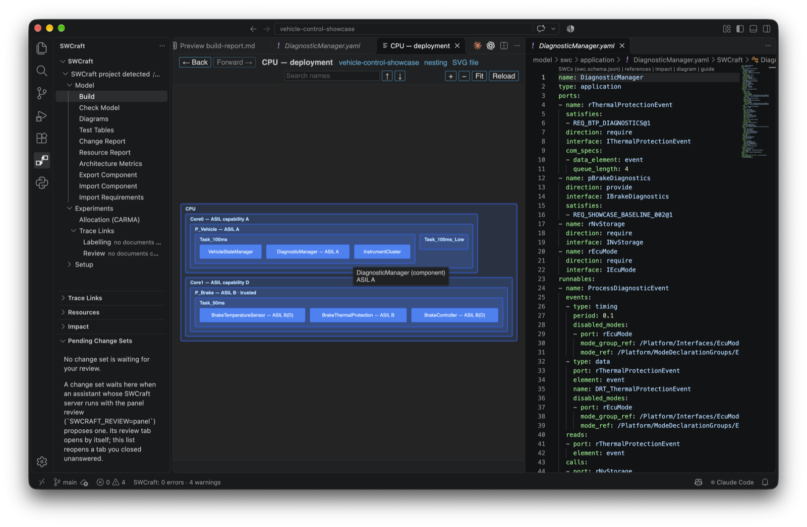
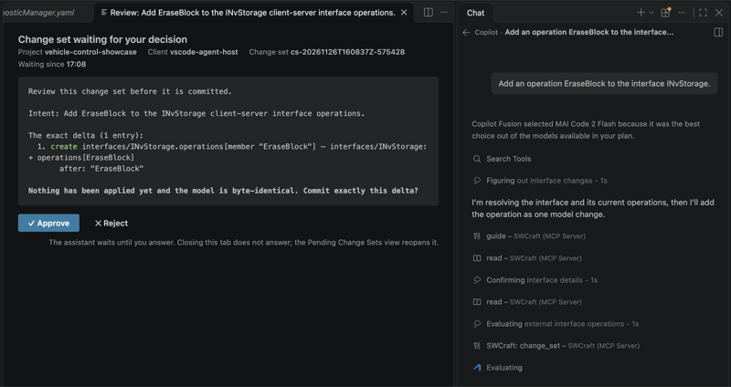
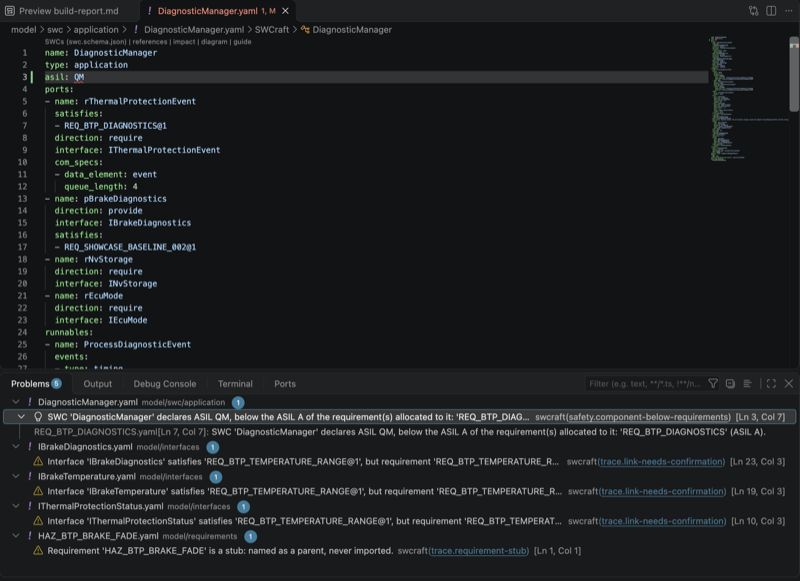

# SWCraft

**Architecture as code for AUTOSAR Classic.**

Your software architecture lives as YAML files in git and is reviewed like code. SWCraft checks the
whole model and generates the ARXML, the diagrams and the requirements trace from it, and an
assistant in VS Code or Kiro proposes changes that you approve or reject.



See it in action — the video and the full tour are on
[swcraft.tarandevich.org](https://swcraft.tarandevich.org).

## What it does

- **The model** — components, ports, interfaces, data types, compositions, tasks and hardware as
  YAML, one file per element, in your own git repository.
- **The gate** — `swcraft validate` checks the whole architecture and says whether it builds.
- **ARXML** — AUTOSAR Classic 4.2.2 or 4.3.0 out of the model, and an existing ARXML export
  imported into one.
- **Diagrams** — component, composition, deployment and sequence views, drawn in a VS Code or Kiro tab.
- **Requirements** — traced through Sphinx-Needs, with the test tables a test team works from.
- **The assistant** — GitHub Copilot, Codex, Claude Code or Kiro, working only through SWCraft:
  every change it proposes opens in a review tab for you to approve.

| The assistant proposes, you decide | The gate finds what breaks |
|---|---|
|  |  |
| Asked for a new operation, the assistant opens a review tab with the exact change; nothing is written until you approve it. | A component set below the safety level of its requirement: the check names the rule and the line, in the Problems panel. |

## Install

SWCraft comes as one archive per platform on the
[Releases page](https://github.com/swcraft-dev/swcraft/releases). Unpack it anywhere.

### Windows

Download `swcraft-<version>-windows-x64.zip`, unpack it and double-click `swcraft_install.cmd`.
The installer adds SWCraft to your `PATH`; open a **new** terminal and check it with
`swcraft --version`.

### macOS

Download `swcraft-<version>-macos-arm64.zip` (Apple silicon), unpack it, and in a terminal inside
the unpacked folder:

```sh
xattr -dr com.apple.quarantine .
./swcraft_install.sh
export PATH="$HOME/.swcraft/current/bin:$PATH"   # the line the installer prints: add it to your shell profile
swcraft --version                                # in a new terminal
```

### Linux

Download `swcraft-<version>-linux-x64.zip`, unpack it, and in a terminal inside the unpacked folder:

```sh
./swcraft_install.sh
export PATH="$HOME/.swcraft/current/bin:$PATH"   # the line the installer prints: add it to your shell profile
swcraft --version                                # in a new terminal
```

The archive carries its own Python and Node.js, and hands the extension to VS Code 1.110 or newer;
into Kiro you install it yourself, as [In Kiro](docs/guide/kiro.md) says. The options and the
answers to the usual problems are in [Getting started](docs/guide/getting-started.md).

## First steps

1. Open an empty folder in VS Code or Kiro and run **SWCraft: Onboard Project** from the Command
   Palette.
2. Press **Build** in the SWCraft panel: the model is checked and the ARXML generated.
3. Press **Diagrams** to see the architecture drawn.
4. Ask the assistant for a change — in Copilot Chat, pick **SWCraft Architect**; in Kiro, use its
   chat once you have trusted the folder and reloaded the window — and approve or reject it in the
   review tab.

Or from the command line:

```sh
swcraft init my-arch
cd my-arch
swcraft validate --project swcraft.yaml
```

Try it on a demo project: the
[Vehicle Control Showcase](https://github.com/swcraft-dev/swcraft-vehicle-control-showcase), a synthetic
automotive architecture to open in VS Code or Kiro and build.

## Learn more

- [swcraft.tarandevich.org](https://swcraft.tarandevich.org) — what SWCraft is, with a short video.
- [The user guide](docs/guide/index.md) — the model, VS Code and Kiro, the assistant, the command
  line and how-to pages for the common changes.
- [Releases](https://github.com/swcraft-dev/swcraft/releases) — the archives to download.
- [Release notes](docs/release-notes/) — what each release changes and what upgrading takes.

Once SWCraft is installed, `swcraft docs` opens the guide of your release in a browser, offline.

## Feedback

Bug reports, questions and suggestions are welcome in
[Issues](https://github.com/swcraft-dev/swcraft/issues).

Working on SWCraft itself? See [CONTRIBUTING.md](CONTRIBUTING.md).

## Licence

SWCraft is licensed under the Apache License, Version 2.0 ([LICENSE](LICENSE)). The name "SWCraft"
is not licensed ([NOTICE](NOTICE)). Third-party software and what a release archive bundles are
named in [THIRD-PARTY-NOTICES.md](THIRD-PARTY-NOTICES.md).
